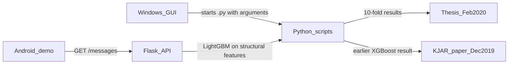

# SMS Spam Detection System Using Hybrid Gradient Boosting with Wrapper Algorithms

> **Historical archive, 2017–2020.** Master of Science project at Sulaimani Polytechnic University, supervised by Dr. Noor Ghazi M. Jameel. Frozen as preserved from that period. Not maintained, and not updated for current Python, Android, or Windows tooling.

This repository preserves the code and thesis behind that degree. The study ran from 2017 to 2020. The thesis is dated February 2020 (Reşemî 2720). A journal article from the same work was published in December 2019.

| | |
| --- | --- |
| Author | Diyari Jalal Mussa |
| Supervisor | Dr. Noor Ghazi M. Jameel |
| Degree | Master of Science in Information Technology |
| College | Technical College of Informatics, Sulaimani Polytechnic University |
| Thesis | February 2020 |
| Journal article | December 2019 (received 5 September 2019, accepted 15 November 2019) |

## Citation

Please cite the thesis and the journal article. GitHub can format both from [CITATION.cff](CITATION.cff).

**Thesis.** Mussa, D. J. (2020). *SMS Spam Detection System Using Hybrid Gradient Boosting with Wrapper Algorithms* (Master's thesis). Technical College of Informatics, Sulaimani Polytechnic University.

- Full text in this archive: [docs/thesis](docs/thesis)
- [Google Scholar record](https://scholar.google.com/citations?view_op=view_citation&hl=en&user=45lJ_j8AAAAJ&citation_for_view=45lJ_j8AAAAJ:d1gkVwhDpl0C)

**Journal article.** Mussa, D. J., & Jameel, N. G. M. (2019). Relevant SMS spam feature selection using wrapper approach and XGBoost algorithm. *Kurdistan Journal of Applied Research, 4*(2), 112–120. https://doi.org/10.24017/science.2019.2.11

- Official PDF: [KJAR download](https://www.spu.edu.iq/kjar/index.php/kjar/article/download/338/237)
- [Google Scholar record](https://scholar.google.com/citations?view_op=view_citation&hl=en&user=45lJ_j8AAAAJ&citation_for_view=45lJ_j8AAAAJ:u5HHmVD_uO8C)

Copyright and dataset terms are in [NOTICE.md](NOTICE.md).

## What was studied

The work detects spam and ham SMS messages with gradient boosting and wrapper feature selection. Messages are represented by structural features (URLs, phone numbers, currency symbols, letter case, message length, and similar signals) rather than a bag of words. Sequential forward selection and sequential backward selection search for a smaller feature set. Classification uses 10-fold cross-validation.

The corpus is the public SMS Spam Collection v.1: 5,574 messages, of which 4,827 are ham and 747 are spam. The file is not in this repository. Download it from the [UCI Machine Learning Repository](https://archive.ics.uci.edu/ml/datasets/sms+spam+collection) and cite Almeida, Hidalgo, and Yamakami (2011), as described in [NOTICE.md](NOTICE.md).

### December 2019 article

Fifteen structural features. Sequential backward selection produced a stronger subset than sequential forward selection. The best reported result is XGBoost with 9 features: accuracy **98.64%**, recall 0.9224, specificity 0.9963, precision 0.9745. Feature identities and the comparison are in Table 2 and Table 3 of the article.

### February 2020 thesis

The feature set is expanded to 18 binary features and 8 numeric features, including currency symbols, service numbers, and currency written as words. Gradient Boosting Machine (GBM), XGBoost, and LightGBM are compared with both wrapper methods. Sequential backward selection again leads. The best reported result is **LightGBM at 99.139% accuracy with 9 features** chosen by sequential backward selection. Chapter 4 of the thesis holds the tables and figures.

## How the pieces fit

The Windows program is an experiment bench. It does not contain the classifiers. It starts the Python scripts and passes the selected options as command-line arguments. Those scripts produced the numbers in the thesis.

The Android application is a demo client from the end of the project. It receives an SMS, sends the text to the Flask API, and stores the spam or ham decision on the phone. The API trains a LightGBM model on ten structural features.

## Repository map

| Path | What it is |
| --- | --- |
| [docs/thesis](docs/thesis) | February 2020 thesis PDF |
| [ml-pipeline](ml-pipeline) | Research copies of the preprocessing, feature-selection, and classification scripts |
| [desktop-gui](desktop-gui) | Visual Studio 2017 WinForms bench that launches those scripts |
| [flask-api](flask-api) | Flask service used by the Android demo |
| [android-app](android-app) | Android demo, version 1.0, titled Lighting SMS Filter |

Each folder has its own README. Two Python snapshots are both kept, because they are not the same file and neither was edited for this archive:

- [ml-pipeline](ml-pipeline) holds the research-folder copies of `Preprocessing.py` and `FeatureSelection.py`.
- [desktop-gui](desktop-gui) holds the copies the Windows bench actually launches. Those copies add a feature-export argument and set `GradientBoostingClassifier(random_state=0)`.
- `TestNewDataset.py` is identical in both places. `Prediction.py` exists only in [ml-pipeline](ml-pipeline).

## Period toolchain

These are the versions recorded with the project. They are part of the historical record.

| Component | Version used in 2019–2020 |
| --- | --- |
| Python | 3.7 |
| numpy | 1.16.2 |
| pandas | 0.24.2 |
| xgboost | 0.82 |
| lightgbm | 2.2.3 |
| sklearn | 0.21.0 |
| mlxtend | 0.16.0 |
| Desktop UI | .NET Framework 4.8, Visual Studio 2017 |
| Android | Gradle plugin 3.6.1, Gradle 5.6.4, compileSdkVersion 28, minSdkVersion 16 |

`sklearn==0.21.0` is the package name used on PyPI at that time. The Android build files still request `jcenter()`.

## Preserved limits

The source files are unchanged copies, so the following details remain in the code:

- Python and dataset paths point at the original computers, including `C:\Users\MSI GP66\...` and `C:\Users\OMEN\...`.
- The Flask route trains LightGBM again on every request and reads `C:\Users\OMEN\Machine Learning Kaggles\Data sets\SMSSpamCollectionfixed.csv`.
- The Android client calls `http://212.24.103.188:8080`. That was the 2020 server. A comment in the same file also mentions `http://10.0.2.2:9090` for the emulator. The Flask development server in this archive listens on port 9090.
- The WinForms assembly information still contains the Visual Studio template line `Copyright © HP Inc. 2019`. The degree work is by Diyari Jalal Mussa.

Virtual environments, NuGet packages, Android build output, and machine-specific IDE files were left out. Local CSV copies that sat beside the Windows bench were left out as well. Use the UCI corpus instead.

## License

Source code in this repository is under the [MIT License](LICENSE). The thesis PDF and the journal article are separate. See [NOTICE.md](NOTICE.md).
